# PRESS

**P**RESS **R**enders **E**very **S**tyle in **S**wift.

A user interface framework for Swift, and the toolkit under it. A program
says what its windows hold, as values, in the manner of SwiftUI; an engine
written in Rust keeps the widgets, lays them out, and takes the keyboard and
the pointer; and a *style* decides what all of it looks like. The style the
engine was born with is one bit deep, black and white in the manner of the
first Macintosh. It is one choice among others: a style is a small library
of its own, chosen when a program starts, and the same program is drawn in
any of them without being built again.

| One bit | Ninety-Five |
| --- | --- |
| 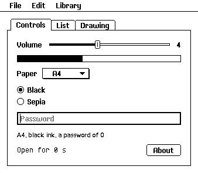 | 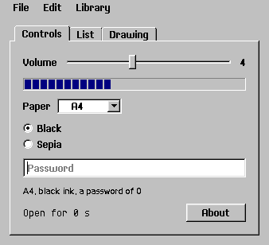 |
| **Ninety-Nine** | **Two Thousand** |
| 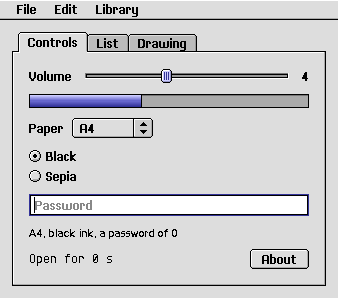 | 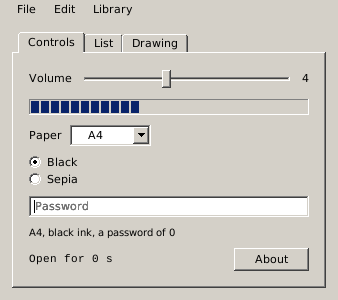 |
| **Two Thousand and One** | **Two Thousand and Five** |
| 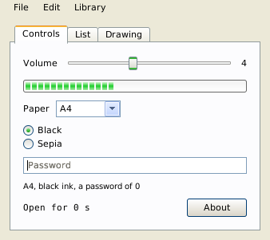 | 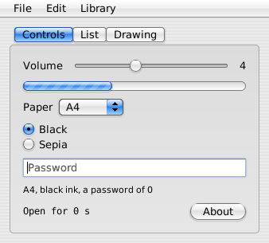 |

```swift
import Press

@main
struct Hello: App {
    var body: some Scene {
        WindowGroup("Hello") {
            Text("Hello from PRESS.").padding(16)
        }
    }
}
```

There are three layers, and each can be used without the one above it:

- **Press**, the Swift library: views, state, scenes and menus under
  SwiftUI's names. See [Press](#press).
- **press**, the engine, behind a flat C interface in `libpress.so`. The
  interface is declared once, in `idl/press.toml`, and the C header, the
  Rust export layer and the Python and Swift bindings are generated from
  it, so C and Python programs are written against the same toolkit.
- **Styles**, which draw. See [Styles](#styles).

PRESS opens windows through Wayland and can render to PNG files without
a display.

## Build and run

```bash
cargo build
```

```bash
swift run --package-path examples/swift HelloUI
```

```bash
swift run --package-path examples/swift GalleryUI
```

```bash
make styles
```

```bash
PRESS_STYLE=ninetyfive swift run --package-path examples/swift GalleryUI
```

```bash
PRESS_STYLE=ninetynine swift run --package-path examples/swift GalleryUI
```

```bash
PRESS_STYLE=twothousand swift run --package-path examples/swift GalleryUI
```

```bash
PRESS_STYLE=twothousandone swift run --package-path examples/swift GalleryUI
```

```bash
PRESS_STYLE=twothousandfive swift run --package-path examples/swift GalleryUI
```

```bash
cc examples/c/hello.c -Iinclude -Ltarget/debug -lpress -o examples/c/hello
```

```bash
LD_LIBRARY_PATH=target/debug ./examples/c/hello
```

```bash
python3 examples/python/hello.py
```

```bash
swift run --package-path examples/swift Hello
```

Each example takes `--snapshot NAME` to render to a PNG without opening a
window. Set `PRESS_BACKEND=headless` to run with no display at all.

Set `PRESS_SCALE` to a whole number from 2 to 8 to magnify everything:

```bash
PRESS_SCALE=2 LD_LIBRARY_PATH=target/debug ./examples/c/hello
```

```bash
cargo test
```

```bash
swift test
```

## Using it in a program of your own

A Swift program names this package as a dependency, by its path or by the
address of its repository, and depends on the product `Press`:

```swift
dependencies: [.package(name: "Press", path: "../press")],
targets: [.executableTarget(name: "Hello", dependencies: [.product(name: "Press", package: "Press")])]
```

The package links against the `libpress.so` built last in its own checkout
(`cargo build` there first), or the one in `PRESS_LIB_DIR` if that is set,
or failing both an installed one. `sudo make install` installs the library,
its headers and the styles under `PREFIX` (`/usr/local`).

## Layout

| Path | What |
| --- | --- |
| `Package.swift` | The Swift package: the libraries `Press` and `PressCore` |
| `bindings/swift/Sources/Press` | Press, the framework, written by hand on top of `PressCore`; its tests are in `bindings/swift/Tests` |
| `bindings/swift/Sources/PressCore` | The engine's interface in Swift, one generated source file (checked in) |
| `bindings/python/press.py` | Generated ctypes binding (checked in) |
| `include/press.h` | Generated C header (checked in) |
| `include/press_style.h` | The interface a style is written against (by hand) |
| `idl/press.toml` | The interface definition: enums, classes, methods, properties, events |
| `crates/press-idl` | Parses the definition; generates the C header, Rust exports and the Python and Swift bindings |
| `crates/press-core` | The engine: handles, widget tree, layout, input, text, and the style interface with the one-bit style. No platform or FFI code |
| `crates/press` | `libpress.so`: the generated exports, their implementation, the display backends, and the loader of styles |
| `styles/ninetyfive` | A style in the manner of the middle 1990s, in C, as a library of its own: grey, bevelled, in the engine's own pixel type |
| `styles/ninetynine` | A style in the manner of the platinum desktops of the end of the 1990s: black outlines and rounded corners in shades of grey, in the engine's own pixel type |
| `styles/twothousand` | A style in the manner of 2000: Ninety-Five told other colours, sizes and smooth type, in forty lines |
| `styles/twothousandone` | A style in the manner of 2001: rounded and shaded, with a glow under the pointer and smooth type |
| `styles/twothousandfive` | A style in the manner of 2005: gel buttons, a default button that throbs, striped windows, soft shadows |
| `styles/common/smooth.h` | What the two smooth styles draw with: blending, gradients, rounded shapes, shadows. Not part of the style interface |
| `fonts/` | The fonts' sources: the scripts that draw them, hand-drawn pixels, the build, and what they borrow (see `fonts/README.md`) |
| `crates/press-fontgen` | Takes the pixels out of the built font files and writes them in the form the engine bundles |
| `assets/fonts` | The bundled fonts, as written by `press-fontgen`, and their licence |
| `examples/` | The same dialog in C, Python and Swift (twice: with `PressCore` and with `Press`), a tour of Press, a host event loop in each, and in C a worker thread, a notes window, scroll bars, a window of other controls, a file browser and a pair of lists to drag between |

## Styles

The engine knows what a button is: where it is, what it says, whether the
pointer is down on it. A style knows what a button looks like. The engine
asks the style in use for these things:

- its **sizes**: how tall a button is, how large a checkbox, how far a text
  field's words stand from its edge, how thick a scroll bar is, how tall a
  row of a list, a tab, a menu's items and the menu bar are, and how much
  room a menu's shadow wants;
- its **colours**: what a window is made of, what paper and ink are in a
  text field, what a menu is;
- its **type**: for each of the engine's six families, one of the machine's
  typefaces and a size, to be drawn smooth from its outlines, or nothing,
  to keep the family in its own pixels;
- what it **wants** of the engine: to be told when the pointer is over a
  button, to have a default button drawn again twenty times a second;
- and, each time a window is drawn, to **draw each part** of it: a button
  with its label, the well round a list, a scroll bar, a tab, a menu's
  frame and shadow, the mark of what is selected, the look of what is out
  of use.

Whatever a style does not draw is drawn in black and white, so a style can
be written a part at a time and is never left with holes in it.

Six come with PRESS. `one-bit` is built into the engine. The other five
are libraries of their own, and are there as much to show how a style is
written as to be worn:

| | |
| --- | --- |
| `ninetyfive` | Grey and bevelled, in the manner of the middle 1990s. Whole pixels and the engine's own type: what a style can be with nothing smooth in it |
| `ninetynine` | Platinum, in the manner of the end of the 1990s: the black-and-white Macintosh in shades of grey. Black outlines, rounded corners, faces lit from the top left; lavender for what is selected in a list and deep blue in a menu. Whole pixels and the engine's own type, which was drawn for a desktop like it |
| `twothousand` | In the manner of 2000: Ninety-Five in a warmer grey and a deeper blue, with smooth type. It is written as that: its colours, sizes and typefaces, and then Ninety-Five's file for the rest |
| `twothousandone` | In the manner of 2001: buttons rounded and shaded from top to bottom, gold where the pointer is, blue for what is selected, green in the progress bar, smooth type, a shadow under menus |
| `twothousandfive` | In the manner of 2005: lozenges of clear and blue gel, a default button that throbs, finely striped windows, a glow round what has the keyboard, menus that cast a soft shadow |

| | |
| --- | --- |
| 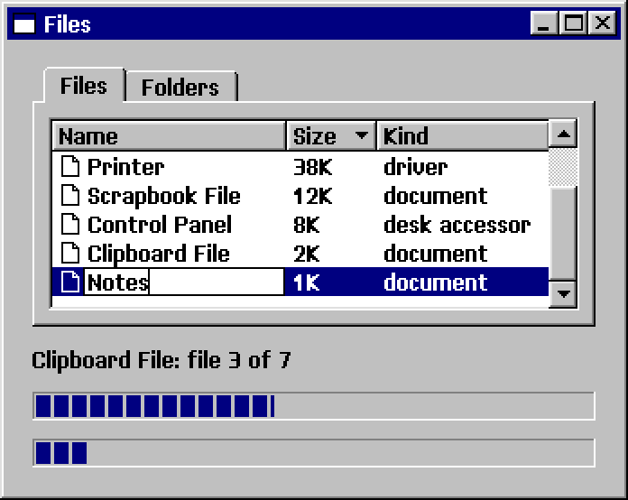 | 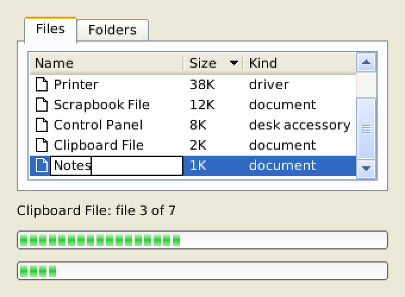 |
| 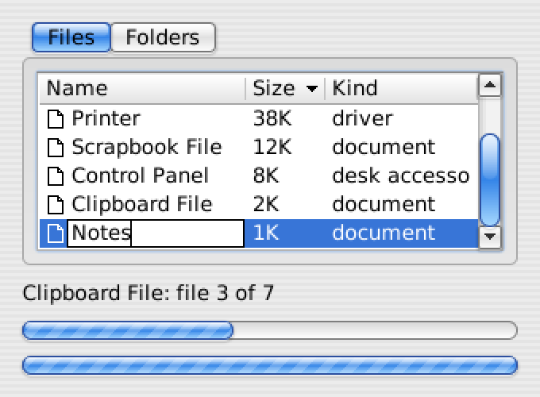 | 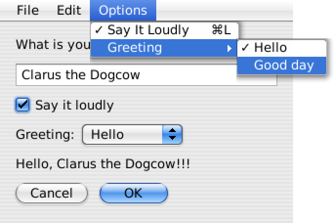 |
| 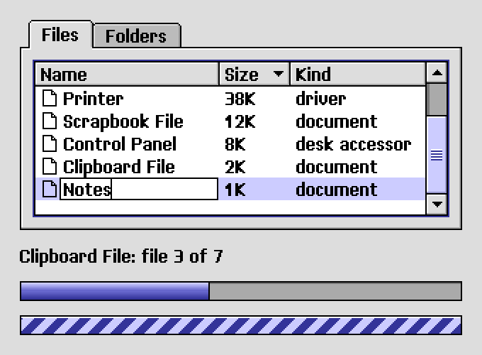 | 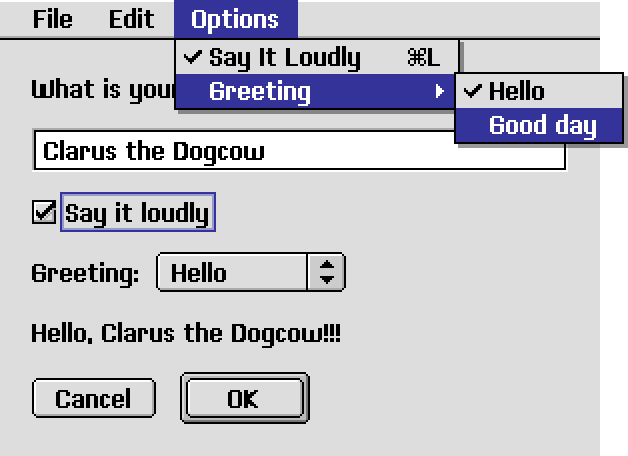 |
| 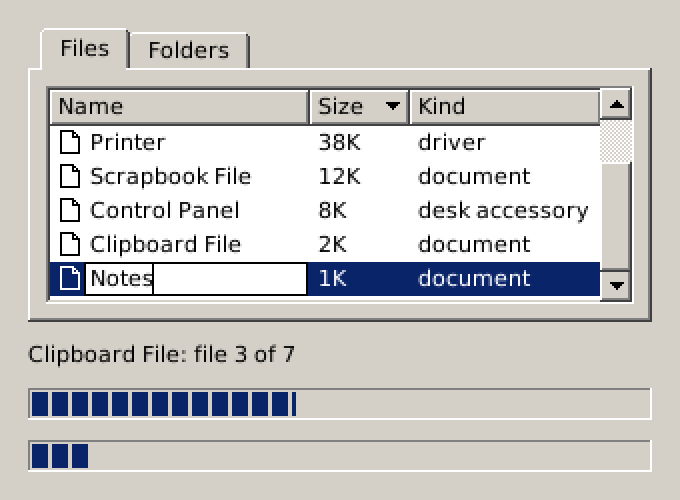 | |

They are drawn here from nothing, in the manner of what they recall: no
picture, colour table or font of Apple's or Microsoft's is in them. For
type they ask for the faces those desktops had, where the machine happens
to have them, and take the nearest thing fontconfig offers where it does
not (DejaVu Sans, on most).

**Choosing one.** `PRESS_STYLE=ninetyfive` in a program's environment
dresses that program; the first line of `~/.config/press/style` dresses
every program that has no such variable. Either is a name or the path of
a library. With neither, or `one-bit`, the interface is black and white. A
style that cannot be loaded is said so once on standard error, and the
program runs in black and white.

**Writing one.** A style is a shared library named
`libpress_style_NAME.so` that exports one function, `press_style_entry`,
written against `include/press_style.h` and nothing else, in any language
that can make such a library. It is handed the pixels of the window, as
colour with alpha, and the engine's own hand for words, and may put
anything there. `styles/ninetyfive/ninetyfive.c` is one in four hundred
lines of C; the two smooth ones share their drawing, `styles/common/smooth.h`,
which another style is free to take or leave. `make styles` builds all
five. A style is looked for in the folders named in `PRESS_STYLE_PATH`, in
`styles/` beside `libpress.so` and beside it, in
`~/.local/lib/press/styles`, and in `/usr/local/lib/press/styles` and
`/usr/lib/press/styles`.

The interface is at its second version. A style made for the first is
still worn as it was written.

A Rust program that embeds the engine can dress it directly:
`press_core::Style` is the same interface as a trait, and
`Ui::set_style` takes anything that implements it.

**What a style does not decide yet.**

- A window's frame and title bar, which belong to the desktop it is on:
- The manners that go with a look: where the menu bar is, which way round
  OK and Cancel go, which key is the command key, where a scroll bar keeps
  its arrows.
- A few sizes: the room round a menu's words and a tab's, the cell of an
  icon view, the border of a menu, which is one pixel.
- Smooth things are drawn a pixel to a pixel and then magnified whole, so
  on a screen magnified two or three times (`PRESS_SCALE`, or a display
  that asks for it) they are as coarse as the pixels are large. Drawing
  them at the screen's own fineness is not done.
- Letters are placed on whole pixels and are not hinted, so small sizes
  are a little softer than those desktops drew them.
- What a program draws itself on a `Canvas` or a `Picture` is its own, and
  is one bit deep (a photo apart) whatever the style, though its words are
  in the style's type.
- The pointer over a tab, a table's heading or a scroll bar is not told to
  a style, only over buttons, checkboxes, radio buttons, pop-ups and
  sliders.

## The ABI

- **Handles, not pointers.** Every object is an opaque 64-bit handle holding a
  slot index and a generation. A destroyed or stale handle returns
  `INVALID_HANDLE`; a handle of the wrong class returns `WRONG_TYPE`.
- **Status codes only.** Every function returns a status; results come back
  through a final out pointer. Panics are caught at the boundary.
- **Strings** are UTF-8 with an explicit length, borrowed for the call.
- **Strings given to a handler** (a text field passes its text with
  `changed` and `submitted`) are lent for the call and NUL-terminated.
- **Events** take a callback, a userdata pointer and an optional destroy
  notifier, which runs when the handler is replaced, disconnected or its
  object is destroyed.
- **Handlers may re-enter.** The engine queues events and delivers them with
  nothing borrowed, so a handler can call any function, including destroying
  the widget that raised the event.
- **One UI thread.** Calls from any thread other than the one that called
  `press_app_init` are refused with `NOT_INITIALIZED`, except
  `press_app_post`, which hands work to that thread.

- **String results** are copied into a buffer the caller supplies. The full
  length always comes back, the copy is NUL-terminated, and a copy that does
  not fit is cut on a character boundary. Pass `NULL, 0` for the length alone.

## Keyboard and focus

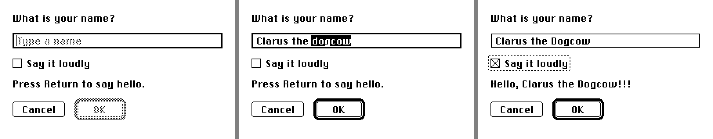

The look is the original Macintosh; the handling is what people expect today.

| Key | Effect |
| --- | --- |
| Tab, Shift+Tab | Move the focus through text fields, checkboxes and buttons |
| Return | Press the default button (and raise `submitted` on a focused field) |
| Escape | Press the button marked `is_cancel` |
| Space | Press the focused button or checkbox |
| Arrows, Home, End | Move the caret; with Shift, select; with Control, by word |
| Backspace, Delete | Delete; with Control, a word |
| Control+A | Select all |
| Control+X, C, V | Cut, copy, paste |

- A window's first text field starts with the keyboard, as in a classic
  dialog. Clicking a button or checkbox does not take the keyboard away from
  the field being typed in.
- A focused text field has a double-weight frame and a blinking caret. A
  focused button or checkbox has a dashed ring that marches for half a second
  when the focus arrives and then rests.
- A button pressed from the keyboard flashes before it reports its click.
- In a text field, drag to select, double-click for a word, triple-click for
  everything. The selection is shown inverted. Long text scrolls.
- What reads as one character is edited as one, however it is written: a
  letter with accents written after it, the parts of a Korean syllable, a
  flag. The caret steps over it whole and never rests inside it, a click
  on it lands before it, and Delete takes all of it. Backspace is the one
  exception: it takes an accent off its letter first, so a wrong one can
  be put right. A letter and its accents are drawn as the font's own
  accented letter where it has one, and otherwise with each accent set
  over or under the middle of the letter.

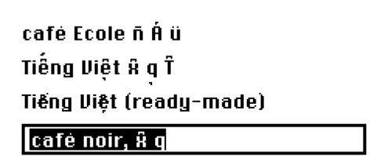
- A **password field** (`press_text_field_set_password`) shows a bullet for
  each character. It cannot be copied, cut or dragged out, input methods
  are kept away from it, and assistive technology is not told its contents.
- A **text area** (`press_text_area_new`) holds several lines. It wraps at
  word gaps to its width, and Return starts a new line rather than pressing
  the default button. Up and Down move by the lines as drawn, keeping
  their column; Home and End go to the ends of the line, and with Control
  to the ends of the text. Text longer than the area scrolls with the
  caret and with the mouse wheel. It keeps tabs, each four spaces wide,
  and holds up to two megabytes, where a field holds 64 kilobytes. A text
  area is a text field: every `press_text_field_*` function and the
  `changed` event work on it.
- A program can see and set what is selected in a text field or area, for
  commands that work on it: `press_text_field_select` selects from one
  place to another (the caret goes to the second), `selection_start` and
  `selection_end` say where the selection is, and the `selected` event
  says so whenever the user moves the caret or changes the selection. The
  places are byte offsets into the text's UTF-8. What the program sets is
  not told back to it, and a password field keeps its caret to itself.

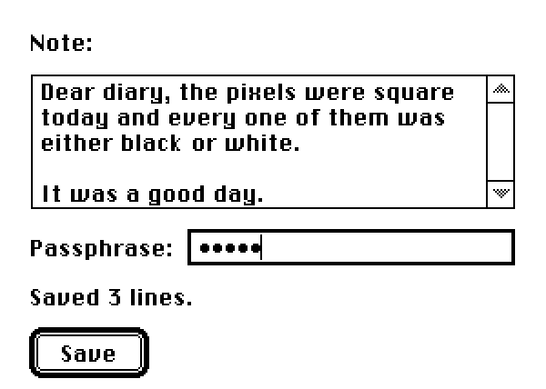

### Scroll bars

A scroll bar has an arrow at each end, a grey track, and a white box that
slides. An arrow moves a step; the track moves a page; the box can be
dragged; the wheel works over it. Holding an arrow or the track repeats.
The box is sized to show how much of the whole is in view, and when
everything fits it disappears and the track turns white.

- A **text area** has one down its right-hand side.
- `press_scroll_bar_new` makes one that stands on its own, vertical or
  horizontal. It scrolls nothing by itself: it holds a `value` from 0 to
  `max`, and raises `changed` when the user moves it. Set `page` to how much
  is in view and `step` to how far an arrow moves.

- A **scroll view** (`press_scroll_view_new`) is a framed opening onto any
  widget, usually a stack of others, that is larger than the space it has.
  It has a bar down its right-hand side, and grows one along the bottom
  only when the content is too wide. The wheel scrolls it from anywhere
  inside. Tab into something out of sight and the view scrolls just far
  enough to show it. What is scrolled out of the opening is neither drawn
  nor clickable.

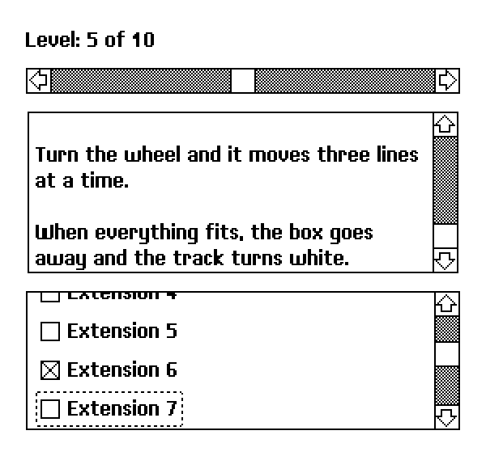
- Keys go through the compositor's keymap, so layouts, dead keys and compose
  sequences work, and held keys repeat.

- Cut, copy and paste use the desktop clipboard while `press_app_run` is
  running, so text moves to and from other applications. Outside it, and
  with the headless backend, they use a clipboard private to the process.
  Pasted line breaks become spaces. `press_text_field_cut`, `_copy` and
  `_paste` do the same from code, ready for an Edit menu.

`press_window_press_key` and `press_window_type_text` feed the same paths
without a display, for tests.

## Windows that change size

When a window is larger than its content needs, the spare room goes to the
widgets that can use it. Nothing has to be said for the usual cases:

- lists, tables, tree views, text areas, scroll views and tab views grow
  both ways;
- one-line text fields and progress bars grow across;
- sliders and scroll bars grow along their length;
- a stack grows if anything in it does, and shares the room evenly among
  those that do;
- labels, buttons, checkboxes, radio buttons and pop-up buttons keep their
  natural size.

`press_widget_set_stretch` overrides this for one widget. Told to grow, a
widget grows along the stack it is in, so an empty label between two
buttons is a spring that pushes them apart. Told not to, it keeps its
natural size.

A window will not go smaller than its content's natural size.

A window can also fill its screen: `press_window_set_full_screen` asks
the desktop for it, and `full_screen_changed` says when the desktop has
done so or undone it, as when the user leaves by the desktop's own means.
The window then has no title bar or frame, and draws no menu bar of its
own. Menu shortcuts still work.

The back and forward buttons on the side of many a mouse are heard as a
window's `navigate` event (`press_window_on_navigate`), with which of the
two it was; what they do is the program's to say. `press_window_side_click`
presses one, for tests.

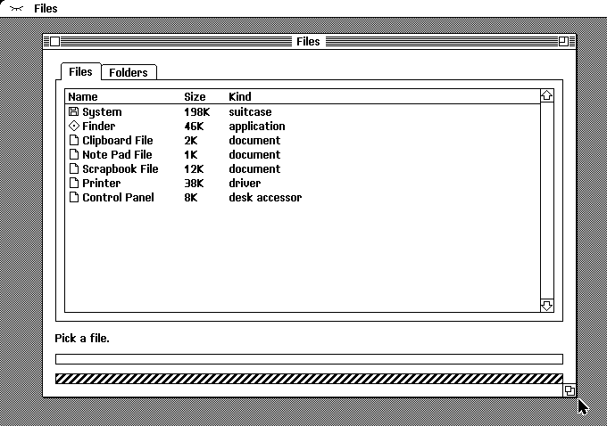

## Menus

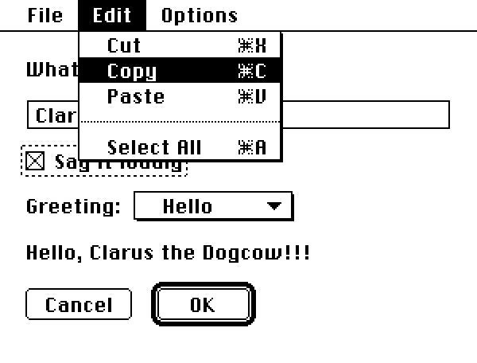

A window can carry a menu bar (`press_window_set_menu_bar`). It is drawn
across the top of the window and takes 20 pixels from the content area. A
pulled-down menu is a surface of its own, so it can hang past the window's
edge.

- **Press, drag, release**, as on the original: press a title, slide to an
  item, let go. Sliding along the bar pulls down each menu in turn.
- **Click, then click**: a click on a title leaves the menu down.
- **Keyboard**: F10 or the Menu key pulls down the first menu; the arrows
  move, Return or Space chooses, Escape puts it away.
- **Shortcuts**: an item's shortcut is one character typed with Control,
  shown beside the item with the command-key sign. The menu's title flashes
  when a shortcut chooses one of its items. While a text field has the
  keyboard, Control with A, C, X or V edits the text instead.
- A chosen item blinks before the menu goes away and `activated` is raised.
- Items can be disabled or carry a check mark; menus can be disabled;
  `press_menu_add_separator` adds a dividing line.
- **Submenus.** `press_menu_item_set_submenu` hangs a menu off an item,
  to any depth. It opens beside the item when the item is pointed at; the
  item shows an arrow and no longer raises `activated` itself. From the
  keyboard, Right or Return goes in and Left or Escape comes back out.

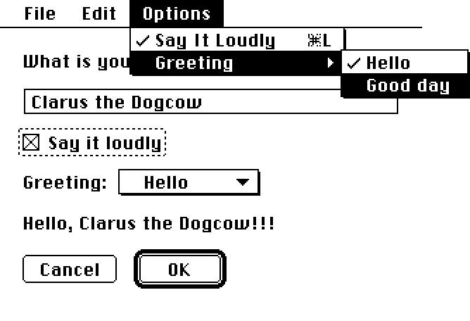

### Context menus

A menu can also pop up at the pointer.

- `press_widget_set_context_menu` gives a widget a menu of its own. It pops
  up on a right click on the widget or anything inside it, so one on the
  window serves the whole window. The Menu key (or Shift+F10) pops up the
  menu of whatever has the keyboard.
- A **text field** with no menu of its own pops up Cut, Copy, Paste and
  Select All, with whatever cannot be done greyed out. Right-clicking a
  field gives it the keyboard first, so the menu acts on the field you
  clicked.
- `press_window_popup_menu` pops a menu up wherever the program asks.

A pop-up is worked like any other menu: click an item, or use the arrows
and Return; submenus work; a click elsewhere or Escape puts it away.

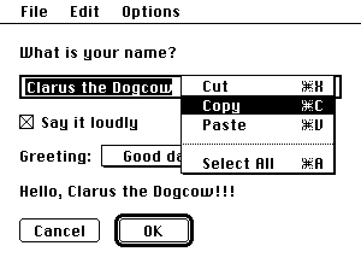

### Pop-up buttons

A pop-up button (`press_popup_button_new`) shows one of a list of choices.
Press it and the whole list comes up over it with the current choice under
the pointer, so pressing and letting go changes nothing and a short drag
picks a neighbour, as on the original. A plain click leaves the list up to
be clicked, and Space pops it up from the keyboard. It raises `changed`
with the index of the new choice.

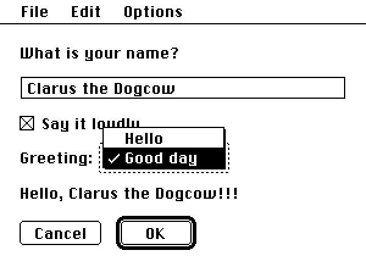

### Radio buttons, sliders and list boxes

- **Radio buttons** that share a parent stack are one group: choosing one
  unchooses the rest. The arrow keys move through the group, choosing as
  they go.
- A **slider** is a number picked by position. Drag the knob, or click
  anywhere on the groove and the knob comes to the pointer. The arrow keys,
  Home, End and the wheel move it too.
- A **list box** shows rows of text, one of which may be selected, and
  scrolls when there are more than fit. The arrows move the selection,
  typing a letter jumps to the next row that starts with it, and a double
  click or Return opens a row (`activated`).

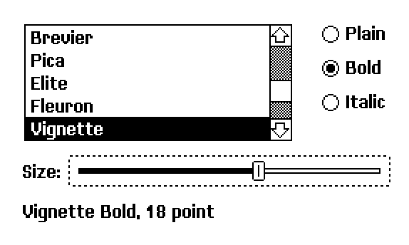

### Icon views

`press_icon_view_new` makes a list box that shows its items as large
pictures with their names beneath, in rows that fill its width, as a
folder's window does. It is a list box in every other way: the same
functions add items, select them, edit a name in place and report what the
user did. An item's picture goes by its icon (a folder, a document or an
application); a picture of the program's own is drawn double size. The
arrow keys go from icon to icon.

With `press_list_box_set_reorderable` on, the user can drag icons to
wherever they like in the view; `placed` reports each one's new place and
`press_icon_view_set_position` puts one somewhere, or back in line. The
order of the items is not changed by any of this.

### Tables, tree views, tab views and progress bars

- A **table** (`press_table_new`) is a list box with columns under a row
  of headings. Rows are added like any list row, with the cells separated
  by tab characters; a cell too long for its column is cut short.
- A **tree view** (`press_tree_view_new`) is a list box whose rows hang
  from one another. `press_tree_view_add_child` adds an item under another
  and returns its index. Click the triangle to unfold or fold; from the
  keyboard Right unfolds and then steps in, Left steps out and then folds.
- Both *are* list boxes: selection, scrolling, type-ahead, `changed` and
  `activated` all work as they do there, through the `press_list_box_*`
  functions.
- A **tab view** (`press_tab_view_new`) holds several pages in the space
  of one. Click a tab, or give the tabs the keyboard and use Left and
  Right. Only the page showing takes part in layout, focus and
  accessibility, and the view is sized for its largest page so it does not
  jump as pages turn.
- A **progress bar** (`press_progress_bar_new`) fills from the left as
  `value` goes from 0 to `max`. Set `busy` for work of unknown length and
  it shows a barber's pole on the move.

Lists, tables and trees can do more when asked:

- **Several rows at once** (`multiple`): Control with a click adds or
  removes a row, Shift with a click or an arrow stretches the selection, a
  drag stretches it, and Control+A takes everything.
- **Sorting** (`sortable`, tables): click a heading to sort by it and again
  to turn the order round; an arrowhead shows which way. Cells that start
  with numbers are ordered as numbers. Sorting changes the order rows are
  shown in and never their indices, so a handler's row 3 is always row 3.
- **Resizing columns:** drag the edge between two headings. The pointer
  changes shape over an edge.
- **Editing in place** (`editable`): Return edits the current row's text
  there and then, as renaming a file does. Return keeps the change and
  raises `edited`; Escape throws it away; a click elsewhere keeps it.
- **Icons:** `press_list_box_set_icon` puts a folder, a document or an
  application before a label, and `press_list_box_set_picture` one of your
  own, drawn in text: `X` is black, a full stop white, a space lets the row
  show through, up to 14 pixels each way.
- **Moving rows** (`reorderable`): press a row and pull it up or down; a
  line shows where it will land. Where several are selected they all go
  together, keeping their order. Like sorting, this changes the order rows
  are shown in and not their indices. `moved` says which item went where.
- **Rearranging a tree** (`reorderable` on a tree view): drag an item
  into the gap between two rows, or onto a row to hang it from that one; a
  line or a box shows which. An item takes along whatever hangs from it,
  and nothing can be dropped into itself. `press_tree_view_parent_of`
  says where an item now hangs.
- **From one list to another** (`accepts_rows` on the list that takes
  them): pull rows across to another list, in the same window or another
  window of the program, and the line shows there. A tree can take rows
  too: onto an item, or between two. What is dragged out of a tree takes
  its whole branch, which keeps its shape in another tree and is laid out
  flat in a plain list. All of this works between two press programs as
  well: the rows are written out by one, read by the other, and removed
  from the first once the second has them. Anything else that takes text
  is given their labels, and the list keeps its rows. They leave the first list and join the second, keeping
  their text and pictures and arriving selected. The first list raises
  `removed` and the second `received`, so a program can keep its own
  records in step. `press_list_box_remove` takes a row out from code.
- Pictures can also be read from a small PNG file with
  `press_list_box_set_picture_file`; it is reduced to one bit.
- While a cell is being edited, cut, copy and paste work as in a text
  field, and so do input methods.

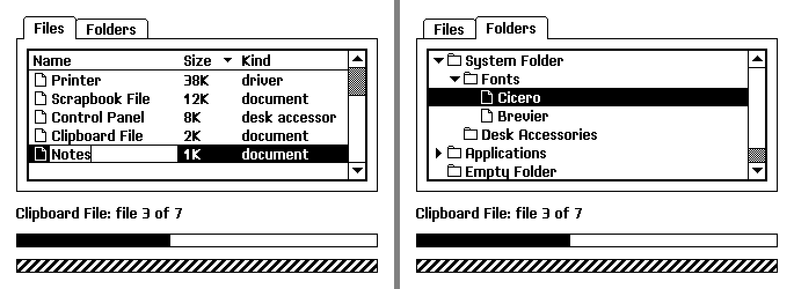

### Pictures

A **picture** (`press_picture_new`) is a white box of a size the program
chooses, for drawing on: a graph, a chart, a diagram. Draw lines (solid,
dotted or dashed), boxes (outlined or filled) and words on it, in its own
pixels from its top left corner; what falls outside is cut off. What is
drawn is kept and drawn again whenever the window is, so a program draws
once and again only when something changes (`press_picture_clear` rubs it
all out). Words are in the picture's typeface, which `set_typeface`
changes, and `press_picture_text_width` says how wide they will be, for
placing them; `press_picture_text_in`, `text_width_in` and
`line_height_in` do the same in a typeface given each time, for a heading
over plain words or code in the even face. A press in it (with the count of clicks), a drag from it
and the release are told to the program with the place, even when the
pointer has gone outside, and so is the wheel turned over it.
`description` says in words what it shows, for screen readers. The
Calculator's graphs are drawn on one.

`press_picture_fill` fills a box with a pattern of black and white, an
8 by 8 tile given as eight bytes, which is how shades and stand-ins for
colours are made on a screen with neither; it covers what was there, so
a pattern of all noughts rubs a box out. With `takes_keys` a picture can
have the keyboard, for a game: Tab stops at it, a press in it takes the
keyboard there, and the arrow keys (`key_pressed`) and what is typed
(`typed`) are told to the program.

`press_picture_image` lays down a picture of the program's own making, a
pixel a bit, for scenes drawn pixel by pixel: one call where dots would
be thousands. The Globe draws its dithered planets and globes that way.

A picture can also stand in for a screen of the program's own, as a
terminal's does. With `raw_keys` it hears every key, as `key_down` with
the key's number (or 0 and the character, for Control or Alt with a
character) and the modifiers held: Tab, Return, Escape, F1 to F12, Page
Up and Down and Insert among them, which otherwise do the window's work.
Control and Shift with a character still choose a menu entry that has it
as its shortcut, and what is typed without Control or Alt still comes as
`typed`. Such a picture is not ringed when it has the keyboard; it shows
where the keys go itself. Told to stretch (`press_widget_set_stretch`), a
picture fills the room its window gives it both ways, and `resized` says
how large that is, the first time it is laid out and whenever the window
changes size; its own size, which `press_picture_set_size` changes, is
then the least it asks for. With `right_button` it hears the right button
too, where it would otherwise pop up a context menu: `right_pressed` and
`right_released` with the place, and where the pointer goes while it is
held by `dragged`, as for the left. `middle_button` does the same for the
middle button, with `middle_pressed` and `middle_released`; nothing else in
press takes it.

### At the top of the screen

On a desktop that shows applications' menus itself, the menu bar goes
there: across the top of the screen, as on the Macintosh. Under KDE Plasma
that is the Global Menu widget (the `MacintoshKDE` layout has one in its top
panel). The window then draws no bar and is 20 pixels shorter, so its
content keeps the room it had and a window fitted to its content stays
fitted. Shortcuts work as before, and choosing an item raises `activated`
exactly as it does from the window's own menus.

The menus are published over D-Bus with the DBusMenu protocol, which is
what Qt and GTK applications use, so this needs nothing from the
application. Where no such desktop is running the bar stays in the window.
`PRESS_MENU_BAR=window` keeps it in the window regardless.

Under Plasma the bar at the top of the screen is drawn by Plasma, in its
style.

## Scale and the pointer

Every engine pixel is drawn as a square of whole device pixels and is never
smoothed. Two factors multiply:

- the buffer scale the compositor asks for, so a window on a 2x output is
  drawn at 2x and follows the window from one output to another;
- `PRESS_SCALE`, your own magnification on top of that.

Windows, menus and the pointer all scale together.

Where the scale is not a whole number, such as 150%, a picture drawn at a
whole scale would be resampled by the compositor and go soft, and one-pixel
patterns do not survive that. So there press draws straight in the
screen's own pixels: each engine pixel is a square as many screen pixels
across as the scale rounded to the nearest whole number (two at 150% or
175%, one at 125%), and the compositor is told to show the picture as it
is. Things come out a little larger or smaller than the scale asks for,
and sharp. This needs a compositor that says what its scale is
(`fractional-scale`) and takes a picture's size on trust (`viewporter`),
as KDE's, GNOME's and the wlroots family do; `PRESS_FRACTIONAL=0` turns it
off and leaves the scaling to the compositor as before.

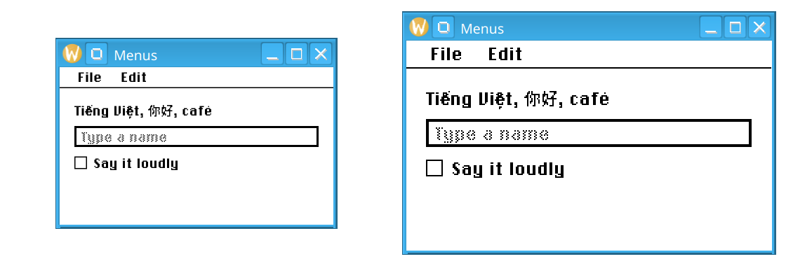

press draws its own pointer in one bit, black edged with white so that it
shows on anything:

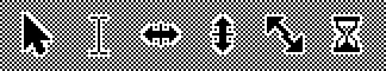

- the arrow, and an I-beam over text that can be edited;
- arrows pointing apart over the edge of a table's column, which can be
  dragged sideways (arrows up and down are drawn too, for edges that move
  that way, though nothing in the toolkit has one yet);
- an hourglass over a window whose program is busy. A program says so
  with `press_window_set_busy`, and says when it is done; the window goes
  on answering the pointer and the keyboard meanwhile. The file manager
  does this while it copies or moves files.

The desktop adds two of its own: the hourglass from when a program is
started until it shows a window (or five seconds have gone), and arrows
cornerwise over a window's grow box and while it is being resized.

## Accessibility

Every window is published on AT-SPI, the Linux desktop's accessibility bus
(through [AccessKit](https://accesskit.dev)), so a screen reader such as
Orca can read it and assistive tools can work it.

- What is exposed: the window and its title, the menu bar with its menus
  and items, labels, buttons (and which is the default), checkboxes and
  their state, text fields with their text and placeholder, what is
  disabled, and what has the keyboard.
- A text field's text is given line by line as it is drawn and character
  by character, with where each character is, where words begin, and
  where the caret and the selection are. So a screen reader can read it
  out a character, a word or a line at a time, say what is typed and
  deleted, follow the caret, and a magnifier can keep up with it. A
  character is what reads as one: a letter with its accents is one.
  A password field gives none of this.
- What can be asked for: press a button, checkbox or menu item; move the
  keyboard to a widget; set a text field's text; move its caret or select
  part of it.
- It costs nothing until something asks: the bridge stays dormant when no
  assistive technology is running.

Everything is also reachable from the keyboard alone, as described above.

## Input methods

Text that the keyboard cannot type directly (Chinese, Japanese, Korean and
others) is entered through the desktop's input method, such as Fcitx 5 or
IBus, over the Wayland text-input protocol. While a text field has the
keyboard the input method is switched on and told where the caret is, so it
can put its candidate list there. The draft it is composing is shown in the
field underlined; what it commits is entered like typed text.

## Drag and drop

- **Text in.** Text dragged from another program can be dropped on a text
  field. A mark shows where it will land; it is inserted there and the
  field takes the keyboard.
- **Files in.** Connect `press_window_on_files_dropped` and files dropped
  anywhere on the window arrive as paths, one per line, with a flag that
  says whether the user asked for copies (Control held, on most desktops)
  rather than a move. What is done with them is the program's affair. A
  window with no handler does not accept files.
- **Files out.** `press_list_box_set_file` says that a row of a list stands
  for a file. Such a row can be dragged out of its list, even one whose
  rows cannot be rearranged, and is offered to wherever it is dropped as
  that file. This is how the file manager's windows work. Rows dragged out
  of their window, from any list, take a picture of themselves along
  under the pointer.
- **Text out.** Press on selected text and drag away to carry it to another
  program or another field. A plain click on a selection still just places
  the caret. The text goes along under the pointer as a picture of itself:
  up to three lines, a long piece cut short with an ellipsis.

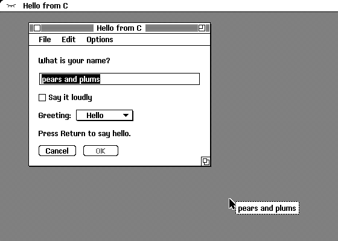

- **Other things.** Text and files are looked after as above; anything
  else a program carries as bytes, named by its kind (a media type such as
  `image/png`). The toolkit does not look inside: what the bytes mean is
  between the programs at either end.
  - `press_app_copy_data` puts something on the clipboard as a kind, and
    `press_app_copy_also` adds another kind beside it: a picture and its
    caption as text, say, so that whoever pastes takes the kind it likes
    best. It can follow text copied from a text field too.
  - `press_window_paste_data` asks for what is there as a kind; the answer
    comes as the window's `data_pasted` event, empty if there is none.
  - `press_window_accept_drops` names a kind the window will take from a
    drag, and `data_dropped` delivers it with where it was let go.
  - `press_list_box_set_drag_data` gives a row something to carry when it
    is dragged out of its list, and `press_list_box_add_drag_data` another
    kind beside it.

  `examples/python/content.py` does all of this with a picture and its name:

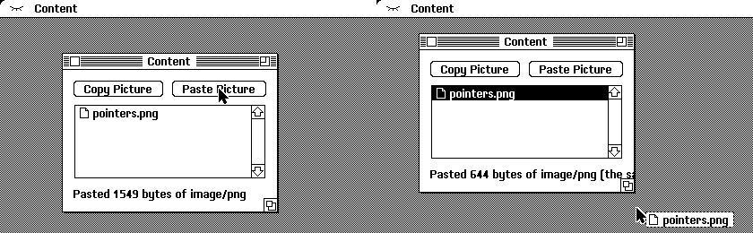

The toolkit itself never moves or deletes anything that is dragged: text is
copied, and files are only named to whoever they are dropped on.

## Using your own event loop

`press_app_run` is a complete event loop for programs that have none. A
program that already has one (a game loop, libuv, GLib, asyncio) keeps it:

1. `press_app_start()` connects to the display and returns.
2. `press_app_fd()` gives one file descriptor. Add it to your loop and watch
   it for readability. Never read from it.
3. Whenever it is readable, call `press_app_dispatch()`. It handles input,
   calls your handlers, redraws, and returns without waiting. It reports
   false once `press_app_quit` has been called or the last window has gone.
4. `press_app_stop()` disconnects.

The descriptor covers everything press needs a turn for, so there is no
timeout to compute: input from the display, the caret blink and other
animations, key repeat, a paste arriving, and any change you make through
the API from outside a handler (a timer of yours setting a label, say).

`examples/c/hostloop.c` does this with `poll()`, and
`examples/python/hostloop.py` with asyncio's `add_reader`.

## Threads

A process has one UI thread: the one that called `press_app_init`. Every
press call must come from it, and a call from any other thread is refused
with `NOT_INITIALIZED`. A second thread cannot become the UI thread until
the first has called `press_app_shutdown`.

The exception is `press_app_post(work, userdata, destroy)`, which any thread
may call. The work is run on the UI thread by the next dispatch (or by
`press_app_run`), in the order posted, and there it may call anything.
Posting wakes the event loop. The destroy notifier runs after the work, or
at shutdown if the work never ran; if `post` itself returns an error,
nothing was taken and neither is called.

`examples/c/worker.c` counts on a worker thread and posts each step to a
label. In Python, `press.App.post(fn)` does the same from any thread.

## Swift

The package's second library, `PressCore`, is the engine's interface as it
is, one call for one call. A program that wants it names the product
`PressCore` in place of `Press`, as `examples/swift` does for `Hello`.

```swift
import PressCore

try App.initialize()
let window = try Window(title: "Hello", width: 200, height: 80)
let button = try Button("Quit")
try button.onClicked { try? App.quit() }
try window.setContent(button)
try window.show()
try App.run()
try App.shutdown()
```

The interface is the one in `idl/press.toml`, spelt as Swift spells things:

- Names are in camel case: `set_min_size` is `setMinSize`, and
  `Status.NotInitialized` is `.notInitialized`. `App.init` is
  `App.initialize`, since `init` is Swift's word for a constructor.
- Every call that can fail throws a `PressError`, which carries the status.
- A property is read as a property, `try field.text`, and set with a
  method, `try field.setText("x")`, because a Swift setter cannot throw.
- Whole numbers are `Int`; bytes are `[UInt8]`; `Modifier` is an
  `OptionSet`, passed as its `rawValue` where the interface takes bits.
- An event takes a closure, `try field.onChanged { text in … }`, and `nil`
  disconnects it. The closure is kept alive until it is replaced or
  disconnected or its object is destroyed. It cannot throw.
- `App.post { … }` hands work to the UI thread from any other.
- An object in Swift is a handle and nothing more. Letting go of it destroys
  nothing; `destroy()` does. `Label(handle: other.handle)` looks at the
  same object as another class, and the library refuses calls that do not
  suit it.

```bash
swift test
```

## Press

`Press` is the library for writing a
program the way a SwiftUI program is written: the program says what its
windows hold, as values, and Press keeps the widgets in step with them.
The dialog at the top of this page, whole:

```swift
import Press

@main
struct Hello: App {
    var body: some Scene {
        WindowGroup("Hello") { Dialog() }
    }
}

struct Dialog: View {
    @State private var name = ""
    @State private var loud = false
    @State private var status = "Press Return to say hello."
    @Environment(\.dismiss) private var dismiss

    var body: some View {
        VStack(alignment: .leading, spacing: 12) {
            Text("What is your name?")
            TextField("Type a name", text: $name)
            Toggle("Say it loudly", isOn: $loud)
            Text(status)
            HStack(spacing: 12) {
                Button("Cancel", role: .cancel) { dismiss() }
                Button("OK") { status = "Hello, \(name)\(loud ? "!!!" : ".")" }
                    .keyboardShortcut(.defaultAction)
                    .disabled(name.isEmpty)
            }
        }
        .padding(16)
    }
}
```

A program depends on the product `Press`, and imports
only that: the two modules use the same names (`Button`, `TextField`, `App`)
for different things. `examples/swift` has this dialog with its menus as
`HelloUI`, and `GalleryUI`, a tour of the rest:


**What is there**, under SwiftUI's names and with SwiftUI's signatures:

| | |
| --- | --- |
| Programs | `App`, `Scene`, `WindowGroup`, `Window`, `.commands`, `.defaultSize`, `.windowResizability` |
| State | `@State`, `@Binding`, `@Bindable`, `@Environment` (by key path or by an observable type), `@Observable` objects, `EnvironmentKey` |
| Structure | `ViewBuilder` with `if`, `if`/`else` and `if let`; `ForEach`, `Group`, `AnyView`, `EmptyView`, `ViewModifier` |
| Layout | `VStack`, `HStack`, `Spacer`, `Form`, `Section`, `LabeledContent`, `ScrollView`, `TabView`, `.padding`, `.frame`, `.fixedSize` |
| Controls | `Text`, `Label`, `Button`, `Toggle`, `TextField`, `SecureField`, `TextEditor` (with a `TextSelection` binding, or without), `Slider`, `ProgressView`, `Picker` (as a pop-up or with `.pickerStyle(.radioGroup)`) |
| Collections | `List` with one selection or a set, `Table` with `TableColumn` |
| Drawing | `Canvas` with `Path`, `stroke`, `fill` and `draw`; words drawn in their own `.font`; a one-bit `Image(bitmap:width:height:)`; `.onTapGesture(count:)` and `.gesture(DragGesture(...).onChanged {}.onEnded {})`; `.onScroll {}` for the wheel, and `.onKeyboard(typed:pressed:)` to take the keyboard, or `.onKeyboard(typed:down:)` to hear every key; `.onRightButton {}` and `.onMiddleButton {}` for the other buttons; `.frame(minWidth:maxWidth: .infinity, ...)` for a canvas that grows with its window, drawn at the room it is given, with `.onResize {}` to hear of it |
| Menus | `CommandMenu`, `CommandGroup`, `.contextMenu`; inside them `Button`, `Toggle`, `Picker`, `Menu`, `Divider`, `Section`; `if` and `if`/`else` among commands |
| Modifiers | `.disabled`, `.font`, `.bold`, `.monospaced` (on a `Text`, giving a `Text`), `.focused`, `.keyboardShortcut`, `.onSubmit`, `.onAppear`, `.onDisappear`, `.onChange(of:)`, `.task`, `.tag`, `.tabItem`, `.navigationTitle`, `.fullScreen(isOn:)`, `.environment` |
| Actions | `@Environment(\.dismiss)`, `@Environment(\.openWindow)` |

**How it works.** A view is a value, made afresh whenever the view above it
is asked for its body. What stays is a node for each view in a window,
which holds the view's state and its widget. When state changes, the views
that read it are asked for their bodies again and the new values are laid
against the nodes: a view of the same kind in the same place keeps its node,
and only what differs is told to the widget, so the caret stays where it
was and a list keeps its scroll. A view that appears is given a new widget
at its place among its neighbours; one that goes has its widget destroyed.
The views of a `ForEach` are known by their ids, so they keep their state
and their widgets when the order changes.

**The event loop** is the main run loop, with press as a guest in it (see
*Using your own event loop*), so `Task`, `async` and `await` on the main
actor work as they do in a SwiftUI program, and `.task` can sleep and count.
State may be changed from any thread; the window is drawn again on the main
one.

**Every window has a menu bar**, with a File menu that holds Quit and an
Edit menu whose Cut, Copy, Paste and Select All work on whichever text
field has the keyboard, as a SwiftUI program has on a Macintosh.
`CommandMenu` adds menus after them, and `CommandGroup` puts commands
before, after or in place of the standard ones.

**Where it parts from SwiftUI**, because press is what it is:

- **What a program draws is black and white**, whatever style its
  controls are in. There are no colours, images, shapes, opacity or
  animations. `Color` has black, white, grey and a light grey, for filling
  boxes on a canvas.
- **Six typefaces, one size each.** SwiftUI's text styles are shared out
  among them: `.body` is Cicero, `.caption` Agate, `.callout` Brevier,
  `.title` Elite, and `.monospaced()` Pica. `Font.press(.pica)` names one
  outright.
- **Layout is press's.** A stack gives each view the size it asks for and
  shares spare room among those that grow. `.frame` sets a least size, not
  a greatest; `.frame(maxWidth: .infinity)` asks to grow; `.padding` is the
  same on every side. There is no `ZStack`, `GeometryReader`, `Grid` or
  `.offset`.
- **A window is as large as its content needs** when it opens, unless
  `.defaultSize` says otherwise.
- **Rows are words.** A `List` row, a `Picker` choice and a `Table` cell
  show the words of a `Text` or a `Label`, and a `Label`'s picture is one
  of press's three icons. A list's `.onSubmit` hears a row opened.
- **Menu shortcuts are one character with Control**, which is press's
  command key; other modifiers are accepted and not used.
- **A tab view's pages cannot be put in another order** once shown, nor
  their tabs renamed; a new page goes on the end.
- **A view of your own inside a menu, a picker or a list is read, not
  kept**: it may have a body, but its `@State` is not remembered there.
  Keep the state in the view that holds the menu.
- **Focus is asked for, not followed.** `.focused` takes a `Bool`
  binding: set true, the view takes the keyboard and it is set back to
  false. There is no `@FocusState` that follows the keyboard about.
- **A field bound to an observable model hears the model change**, as in
  SwiftUI: what a control's bindings read is watched as a body's reads are.
- **Not there yet**: navigation (`NavigationStack`, sheets, alerts),
  gestures other than a click on a canvas, drag and drop, `@AppStorage`,
  and the `ObservableObject` family (`@Observable` is).

To look at a Press program without a screen, `PRESS_SNAPSHOT=file.png`
with `PRESS_BACKEND=headless` draws its first window to a PNG file and
stops.

The engine bindings expose `Stack.insert` to insert or move a child,
`Window.fit` to size a window to its content, and `Window.focused` to find
the widget with keyboard focus. You can also change a checkbox's caption.

Use `select`, `selection_start`, `selection_end`, and the `selected` event
to work with a text field's selection. Text areas support tabs and long
documents. Use `text_in` to draw text in a chosen typeface.

A canvas can draw a bitmap and report pointer drags and double-clicks.
`Window.drag_at` simulates a drag in tests. `Picture.photo` displays a color
image, and snapshots of windows showing one preserve the color.

## Changing the interface

1. Edit `idl/press.toml`.
2. Run `cargo run -p press-idl` to rewrite the header and bindings.
3. Add the matching function to `crates/press/src/api.rs`. The build fails
   until its name and signature agree with the definition.

`cargo run -p press-idl -- --check` fails if the checked-in header or bindings
are out of date.

## Licence

GPL-3.0-or-later. The bundled fonts are the Fonts of Old families,
Copyright 2026 The Fonts of Old Project Authors, under the SIL Open Font
License 1.1; their Chinese, Japanese and Korean characters come from
Fusion Pixel Font and the projects it draws on, under the same licence
(see `assets/fonts/OFL.txt` for all of it). All drawing is original;
nothing is taken from Apple or from Microsoft.
